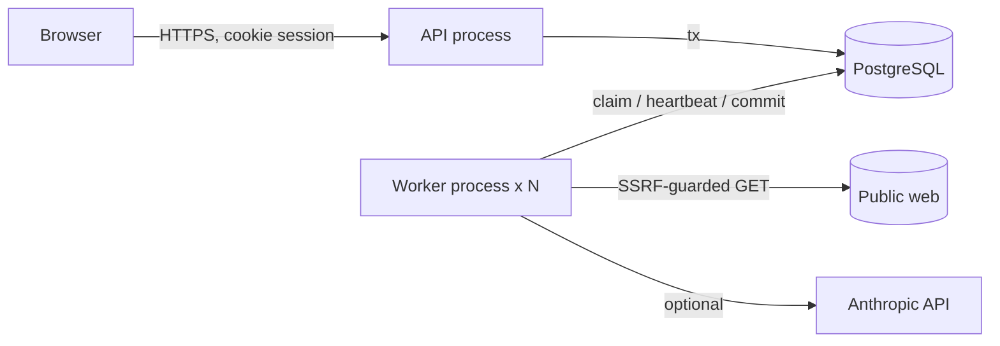

# Architecture

```
apps/web         React 19 + Vite SPA. No business logic; talks to /api/v1 only.
apps/server      Fastify API (api-main) and background worker (worker-main) — two processes, one codebase.
packages/contracts  Zod schemas and TypeScript types shared by web and server.
PostgreSQL       Single source of truth: identity, tenancy, ledger, task graph, job queue, evidence.
```



## Request path

`onRequest` resolves the session cookie (SHA-256 lookup), enforces origin + CSRF for writes, and attaches `AuthContext { userId, workspaceId, planId, role }`. Route handlers validate bodies with the shared Zod schemas and call domain services that take the `AuthContext`, so every query is scoped by `workspace_id`.

## Domain modules (`apps/server/src`)

| Module | Responsibility |
|---|---|
| `auth/` | Argon2id passwords, opaque session tokens, CSRF tokens, audit log |
| `billing/` | Plan catalogue, millicredit ledger (reserve → charge/release), weighted metering |
| `orchestrator/intent.ts` | Deterministic goal interpretation and capability-gap detection |
| `orchestrator/planner.ts` | Builds the task graph and plan hash |
| `orchestrator/state-machine.ts` | The only way task/execution status changes; validated, guarded, audited |
| `orchestrator/executions.ts` | Create / approve / cancel / read executions |
| `engine/` | Durable queue, worker loop, job runner, dependency progression, finalization |
| `capabilities/` | `web.fetch`, `doc.compose`, `checklist.compose`, the safe fetcher |
| `models/` | Capability registry, cost-aware router, Anthropic adapter, usage-recording gateway |
| `verification/` | Independent verifier and outcome receipt builder |
| `http/app.ts` | Routes, security headers, error mapping, static hosting of the SPA in production |

## Data model

See `apps/server/src/db/migrations/001_init.sql`. Key tables: `users`, `workspaces`, `memberships`, `sessions`, `credit_accounts`, `credit_ledger`, `executions`, `tasks`, `execution_events` (append-only transition log), `jobs` (queue), `artifacts`, `model_calls`, `receipts`, `audit_log`.

## Why this shape

One deployable codebase with two process types keeps operations simple while the worker scales independently. Postgres is the queue (see DECISIONS.md, D-002) so that job state, task state and evidence commit in one transaction.
